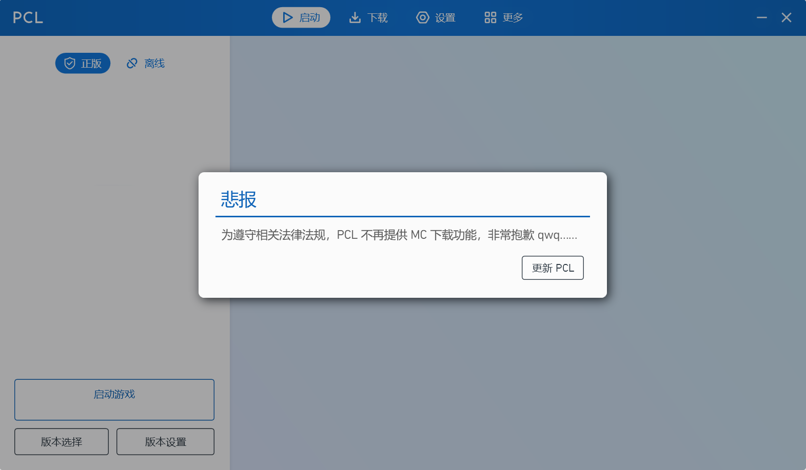
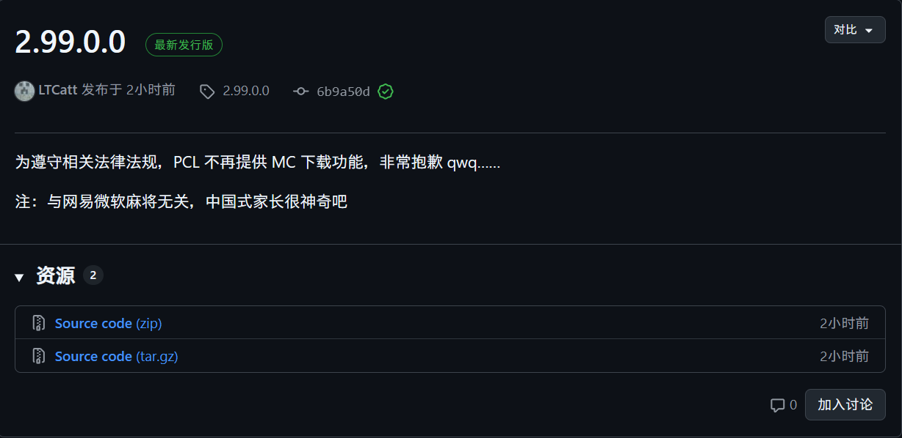
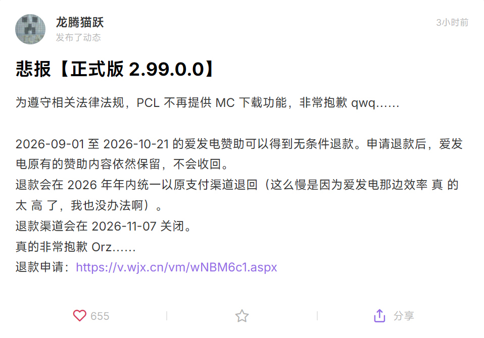

# PCL2-2026年10月20日事件

## 事件

[PCL2](https://meloong.com/PCL)，全称 Plain Craft Launcher 2。是由 [**龙腾猫跃**](https://space.bilibili.com/11343203) （简称“龙猫”）开发的 Minecraft 启动器。

龙猫 在 2026年10月20日 04:41:53 发布了一则 [BiliBili 动态](https://t.bilibili.com/1261020063318671366) ，随后在 2026年10月20日 15:19:17 在动态下方做出回复：*“注：与网易微软麻将无关，中国式家长很神奇吧”*。如下图所示：

同时根据 [HMCL（Hello Minecraft! Launcher）](https://hmcl.huangyuhui.net/) 的开发者 [**Glavo**](https://space.bilibili.com/20314891) 的 [动态](https://www.bilibili.com/opus/1261188623656550402) ——*“别问了，原因是有小孩在服务器里充钱，结果被家长举报了，就是这样。[Rabi-Ribi_GG]”* 以及 PCL2 自己的公告、Github 记录、龙猫的爱发电 等都可以表明明面上确实是因为中国家长举报导致的。见下图：

## 启动器状态

### PCL

正式版 2.99.0.0 已失去下载 Minecraft 本体的功能，可使用上一个正式版 2.14.0.0 。尚不清楚这是暂时规避风险还是长期措施。

### PCL 社区版

PCL 社区版（PCL-CE），即 [PCL Community Edition](https://ce.pclc.cc/)，已在 2.15.0 版本后跟进限制中国地区下载 MC 本体功能。详见 [#3673](https://github.com/PCL-Community/PCL-CE/pull/3673) 和 [更新日志](https://github.com/PCL-Community/PCL-CE/releases#:~:text=install%3A%20%E4%B8%AD%E5%9B%BD%E5%A4%A7%E9%99%86%E5%9C%B0%E5%8C%BA%E7%A6%81%E7%94%A8%20Minecraft%20%E5%AE%89%E8%A3%85%E5%8A%9F%E8%83%BD%20(%233673)%20by%20%40Big%2DCake%2Djpg%20in%20%233673) 。

### HMCL

Glavo 已提交了在中国大陆地区禁用游戏下载功能（[#7017](https://github.com/HMCL-dev/HMCL/pull/7017)），预览版 3.17.0.362 实装此功能，稳定版 3.16.4 暂未更新。

### BakaXL

[BakaXL](https://www.bakaxl.com/) 的开发者 [TT702](https://space.bilibili.com/515094) 已发布 [动态](https://www.bilibili.com/opus/1261524425653616644) 宣布「BakaXL Network」服务停机维护。

### Axolotl

[Axolotl Launcher](https://axlmc.org/) 是一个使用人数相对较少的启动器，开发者 [Mystic_Stars](https://space.bilibili.com/2007491365) 未发表任何相关言论，但其在 [Github 更新记录](https://github.com/Mystic-Stars/Axolotl/releases#:~:text=%E3%80%90%E5%85%B3%E4%BA%8E%E8%BF%91%E6%9C%9F%E5%90%AF%E5%8A%A8%E5%99%A8%E6%9C%89%E5%85%B3%E9%97%AE%E9%A2%98%E7%9A%84%E8%AF%B4%E6%98%8E%E3%80%91%0A%E7%9B%AE%E5%89%8D%E7%BE%8E%E8%A5%BF%E8%9E%88%E5%90%AF%E5%8A%A8%E5%99%A8%E5%8F%AF%E4%BB%A5%E4%B8%8B%E8%BD%BD%E6%B8%B8%E6%88%8F%E6%96%87%E4%BB%B6%EF%BC%8C%E4%B8%94%E6%9A%82%E6%97%A0%E7%A6%81%E7%94%A8%E6%AD%A4%E7%B1%BB%E5%8A%9F%E8%83%BD%E7%9A%84%E8%AE%A1%E5%88%92%E3%80%82) 中说明暂时没有禁用此类功能的计划。

### 汇总

| 启动器  | 状态                          | 版本                               |
| ------- | ----------------------------- | ---------------------------------- |
| PCL     | ❌停止支持下载 MC 本体功能     | 正式版 2.14.00 之后的 2.99.0.0 实装 |
| PCL-CE  | ❌限制中国地区下载 MC 本体功能 | 2.15.0 版本之后实装，可正常使用 [2.15.0](https://github.com/PCL-Community/PCL-CE/releases/tag/v2.15.0) 版本|
| HMCL    | ❌限制中国地区下载 MC 本体功能 | 预览版 3.17.0.362 实装             |
| BakaXL  | ❌「BakaXL Network」线上服务暂停 | BakaXL 3.0+ / BakaXL 4.0+      |
| Axolotl | ✅正常                         | /                                  |
| [ZL2](https://github.com/ZalithLauncher/ZalithLauncher2) | ❌限制中国地区下载 MC 本体与陶瓦联机功能 | 2.7.2 版本受影响，2.7.1 以及以前版本不受影响 |

## 省流

未成年给私服充钱，被中国式家长一起连着启动器举报了。PCL、PCL-CE、HMCL、BakaXL、ZL2 主动进行了风险规避。注：请以官方后续公告为准，不要传播未经证实的个人信息。
